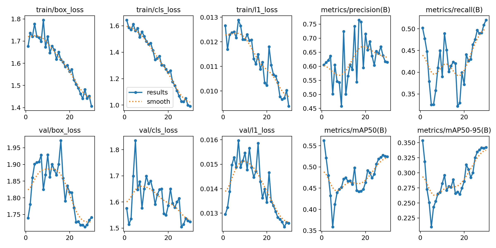
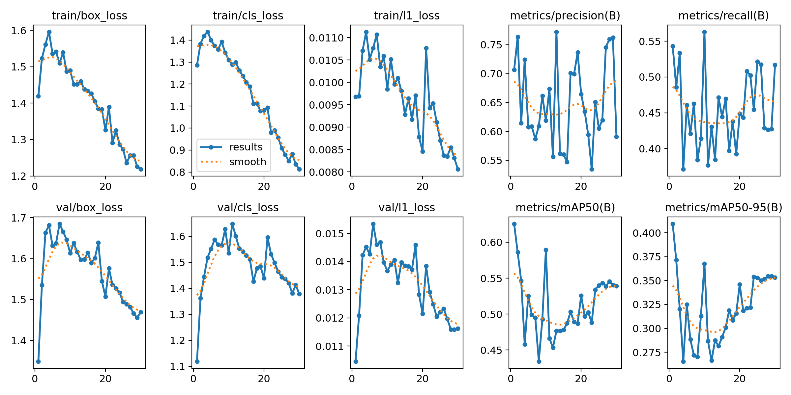
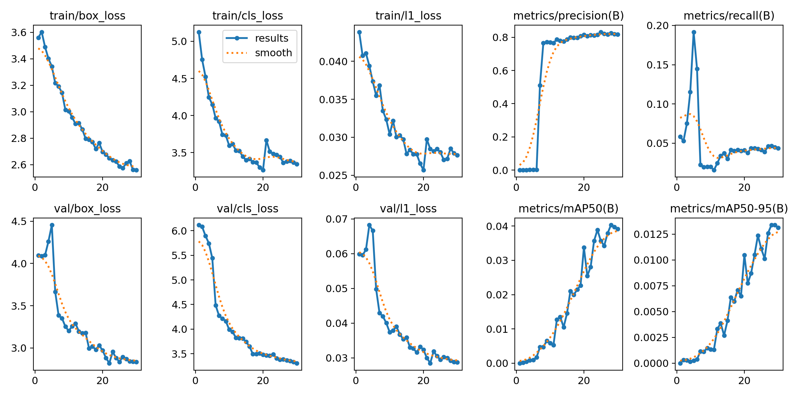

# Pj1 RET503: Sistem Persepsi Robot Quadruped untuk Inspeksi Kualitas Udara dan Termal Indoor

| | |
|---|---|
| Nama | Cyntia Elisabeth Lumbantoruan |
| NIM | 4222411045 |
| Sidik jari dataset | `5F296EAA5CF8` |
| Lingkungan | Google Colab, GPU Tesla T4, Ultralytics 8.4.178, model YOLO26n |
| Dataset dan hasil lengkap | (https://drive.google.com/drive/folders/1o0rVUZ2cypIgjvrNGdYqbJdj8KhT7BqV?usp=drive_link) |

Bagian target kinerja dan rancangan pipeline (bagian 2 dan 3) adalah usulan pada tahap konsep. Projek robot saya baru sampai tahap desain CAD dan elektrikal, dan program akan dibuat semester depan, jadi nilai-nilainya akan disesuaikan setelah perangkat keras ditetapkan bersama kelompok.

---

## 1. Lingkup persepsi

Robot quadruped 12 DOF dalam projek ini bertugas memeriksa kualitas udara dan kondisi termal di dalam ruangan, dengan workspace BRAIL sebagai lokasi uji. Sensor udara dan kamera termal mengukur kondisi ruangan, sedangkan kamera RGB dengan YOLO dipakai untuk menjawab dua hal: objek apa yang ada di depan robot, dan di mana posisinya. Dari posisi itu robot bisa mengarahkan sensor ke target yang tepat dan menghindari rintangan.

Ada empat kelas yang saya pilih. Pilihan ini dibatasi oleh dua hal: objeknya harus ada di workspace BRAIL dan harus tersedia di COCO.

| class_id | Kelas | Alasan untuk robot |
|---|---|---|
| 0 | person | Manusia menghasilkan CO₂ dan panas sehingga memengaruhi pembacaan udara, dan robot juga perlu menjaga jarak demi keselamatan |
| 1 | laptop | Sumber panas yang suhu permukaannya perlu dicek |
| 2 | tv (termasuk monitor) | Sumber panas yang suhu permukaannya perlu dicek |
| 3 | chair | Rintangan bagi robot berkaki di ruangan yang dipakai banyak projek |

## 2. Target kinerja (usulan)

| Metrik | Target | Hasil model terpilih (E3) | Status |
|---|---|---|---|
| mAP50 | ≥ 0,60 | val 0,635, test 0,640 | tercapai pada data COCO |
| Recall | ≥ 0,60 | val 0,525, test 0,692 | belum tercapai di val, tercapai di test |
| Kecepatan | ≥ 10 FPS di perangkat robot | 6,3 ms per gambar di GPU T4 | belum diukur di perangkat robot |

Saya memilih recall sebagai salah satu target karena untuk robot inspeksi, melewatkan orang atau sumber panas lebih merugikan daripada kotak yang kurang rapi atau sesekali salah deteksi. Karena itu recall saya anggap sama pentingnya dengan mAP50. Angka 0,60 saya ambil sebagai patokan awal yang masuk akal untuk model nano dengan data sekecil ini. Target kecepatan 10 FPS saya tentukan dengan perkiraan bahwa robot berjalan pelan di dalam ruangan, sehingga 10 gambar per detik cukup untuk melihat objek sebelum robot mendekat. Angka ini perlu dicek ulang saat kecepatan jalan robot sudah diketahui.

Hasil kecepatan di tabel diukur di GPU Colab, jadi belum menggambarkan kecepatan di perangkat robot.

## 3. Rancangan pipeline (usulan)

```
Kamera RGB -> ambil frame -> resize -> YOLO nano -> NMS
  -> kotak, kelas, dan confidence
  -> posisi kotak dipetakan ke area di kamera termal
  -> baca suhu area tersebut / arahkan sensor udara ke target
  -> catat hasil inspeksi, hindari rintangan (chair, person)
```

| Komponen | Usulan | Alasan |
|---|---|---|
| Kamera | Kamera RGB di bagian depan badan, ditambah kamera termal terpisah | Deteksi objek butuh warna dan tekstur, sedangkan kamera termal resolusinya rendah dan dipakai untuk membaca suhu pada area yang sudah terdeteksi |
| Perangkat pemroses | Jetson Orin Nano, dengan Raspberry Pi 5 sebagai alternatif | Jetson punya GPU sehingga lebih mungkin menjalankan YOLO secara real time. Raspberry Pi lebih murah tetapi kecepatannya perlu diuji dulu |
| Model | YOLO26n dengan imgsz 640 (E3) | Model nano paling ringan, dan resolusi 640 memberi akurasi lebih baik dengan tambahan waktu yang kecil |

Beberapa risiko yang sudah terlihat sejak sekarang:

- Kamera ikut bergoyang saat robot melangkah, sehingga gambar bisa buram.
- Kamera robot dipasang rendah dan sudut pandangnya berbeda dari foto COCO yang kebanyakan diambil manusia.
- Kecepatan baru diukur di GPU Colab, belum di perangkat yang akan dipakai robot.

---

## 4. Dataset (Tahap 1 dan 2)

Dataset saya ambil dari COCO val2017 memakai `00_ambil_subset_coco.py` dengan kelas person, laptop, tv, dan chair. Saya memilih COCO karena keempat kelas itu tersedia dan sesuai dengan objek di BRAIL. Objek yang tidak ada di COCO, seperti kompresor, rencananya akan saya buat sendiri sebagai dataset tambahan.

Saya mengambil 600 gambar berobjek dan 60 gambar latar tanpa objek, jadi totalnya 660 gambar dengan 2718 kotak.

| Kelas | Jumlah kotak |
|---|---|
| person | 2158 |
| laptop | 58 |
| tv | 55 |
| chair | 447 |

Pada percobaan pertama saya memakai 300 gambar, tetapi kotak laptop dan tv hanya 38 dan 25. Setelah dibagi train, val, dan test jumlahnya terlalu sedikit, jadi saya ulang dengan 600 gambar. Hasilnya naik menjadi 58 dan 55, walaupun tetap jauh lebih sedikit dari person.

Hasil pemeriksaan anotasi dengan `01_cek_anotasi.py`:

- Tidak ada gambar yang kehilangan file label.
- Ada 180 peringatan, semuanya bertipe kotak sangat kecil (sekitar 4 sampai 14 piksel). Sebagian besar berasal dari orang di latar belakang. Saya biarkan karena itu bukan kesalahan format, dan saya cek terpisah bahwa tidak ada baris yang formatnya salah (hasilnya 0).
- Dari cek visual pada beberapa gambar, kotak umumnya pas dengan objeknya. Ada beberapa anotasi COCO yang terlihat janggal, misalnya kotak yang mengelilingi benda yang kurang jelas.

Konversi YOLO ke COCO lalu kembali ke YOLO saya uji pada 660 file label, dan tidak ada satu pun yang berubah.

Pembagian data memakai `05_split_dataset_yolo.py` dengan proporsi 70/20/10:

| Bagian | Gambar | Kotak |
|---|---|---|
| train | 461 | tidak dihitung |
| val | 132 | 519 (person 397, laptop 20, tv 12, chair 90) |
| test | 67 | 259 |

Data ini sangat tidak seimbang. Person mendominasi, sedangkan laptop dan tv di data val hanya 20 dan 12 kotak, sehingga hasil kedua kelas itu harus dibaca dengan hati-hati.

---

## 5. Hasil eksperimen (Tahap 3 sampai 5)

Semua eksperimen memakai pengaturan yang sama: epochs 30, imgsz 416, batch 16, dan seed 0. Satu-satunya perubahan ada di E3, yaitu imgsz menjadi 640.

| Eksperimen | Perubahan | mAP50 | mAP50-95 | P | R | ms/gambar | Menit latih |
|---|---|---|---|---|---|---|---|
| E1_pretrained | baseline | 0,573 | 0,366 | 0,591 | 0,525 | 5,1 | 3,8 |
| E2_scratch | bobot acak | 0,040 | 0,013 | 0,819 | 0,043 | 2,9 | 3,4 |
| E3_tuning | imgsz=640 | 0,635 | 0,412 | 0,728 | 0,525 | 6,3 | 4,5 |

Model terpilih adalah E3, karena mAP50-95 di data val paling tinggi. Model ini diuji satu kali di data test dan mendapat mAP50 0,640, mAP50-95 0,465, presisi 0,541, dan recall 0,692.

Karena `best.pt` E1 dan E3 ternyata berasal dari epoch awal (lihat bagian 6c), saya menambahkan evaluasi E1 pada resolusi 640 dan hasil per kelas. Semuanya dihitung pada data val, nilainya mAP50-95:

| Kelas | Kotak di val | E1 @416 | E1 @640 | E3 @640 |
|---|---|---|---|---|
| person | 397 | 0,378 | 0,373 | 0,517 |
| laptop | 20 | 0,394 | 0,447 | 0,447 |
| tv | 12 | 0,443 | 0,456 | 0,414 |
| chair | 90 | 0,249 | 0,248 | 0,269 |
| semua | 519 | 0,366 | 0,381 | 0,412 |

### Grafik pelatihan

E1_pretrained



E3_tuning



E2_scratch



---

## 6. Analisis

### a. Transfer learning (E1 dan E2)

Hasil E1 dan E2 berbeda sangat jauh. E1 mendapat mAP50-95 0,366, sedangkan E2 hanya 0,013. Recall E2 cuma 0,043, artinya hanya sekitar 4% objek yang berhasil ditemukan. Presisinya memang tinggi (0,819), tetapi itu karena modelnya hampir tidak berani membuat prediksi, jadi angka tersebut tidak bisa dibaca sebagai hasil yang bagus. Di grafik E2, loss masih turun dan mAP masih naik sampai epoch terakhir, jadi sebenarnya model ini belum selesai belajar. Dengan 461 gambar latih dan 30 epoch, belajar dari nol memang belum cukup.

E1 membawa bobot hasil latihan di COCO. Keempat kelas saya ada di COCO, jadi wajar kalau E1 sudah bisa mengenali objeknya sejak awal. Jadi keunggulan E1 pada percobaan ini lebih banyak datang dari pengetahuan COCO yang sudah ada daripada dari proses fine-tuning, dan ini berlaku untuk data dan jumlah epoch yang saya pakai.

### b. Pengaruh perubahan imgsz=640 (E1 dan E3)

Dengan imgsz 640, mAP50-95 naik dari 0,366 menjadi 0,412. Harganya, waktu inferensi naik dari 5,1 ke 6,3 ms (sekitar 23% lebih lama) dan waktu latih naik dari 3,8 ke 4,5 menit.

Supaya tahu dari mana kenaikan itu berasal, saya mengevaluasi model E1 pada resolusi 640 juga, dan hasilnya 0,381. Jadi sekitar 0,015 dari kenaikan datang dari resolusi saat evaluasi, dan sisanya sekitar 0,031 datang dari pelatihan pada 640. Perubahan paling besar ada di kelas person, dari 0,373 menjadi 0,517, dengan recall naik dari 0,634 ke 0,690. Dugaan saya, orang yang kecil atau jauh lebih mudah terlihat pada resolusi lebih tinggi. Ini sejalan dengan hasil cek anotasi, di mana banyak kotak kecil berasal dari orang di latar belakang.

Hasil ini perlu dibaca hati-hati. Saya hanya menjalankan satu kali dengan satu seed, data val hanya 132 gambar, dan mAP val bergeser sampai sekitar 0,03 dari epoch ke epoch. Selisih 0,03 antara E1 dan E3 bisa saja masih termasuk fluktuasi biasa.

### c. Kurva pelatihan

Pada E1 dan E3, loss pelatihan turun terus sampai epoch 30. Tetapi performa di data val tidak mengikuti. mAP50-95 val tertinggi justru ada di epoch 1 (E1 0,354 dan E3 0,409), kemudian turun, dan baru naik lagi di epoch-epoch terakhir. Akibatnya `best.pt` E1 dan E3 adalah checkpoint epoch 1.

Loss validasi juga naik di awal. Pada E3, box loss val naik dari sekitar 1,35 ke sekitar 1,68 di epoch 4, dan cls loss val naik dari sekitar 1,12 ke sekitar 1,65 di sekitar epoch 11, sebelum turun lagi. Pada E1 polanya mirip, dengan box loss val sempat mencapai sekitar 1,97 di epoch 16.

Dugaan saya, di fase awal fine-tuning bobot dari COCO sempat bergeser, sehingga model butuh waktu untuk pulih. Saya belum menguji penyebabnya, jadi ini baru dugaan. Ini juga bukan overfitting yang biasa, karena loss validasi akhirnya turun lagi dan mAP naik di akhir. Kenaikan mAP setelah epoch 20 bertepatan dengan berhentinya augmentasi mosaic (mulai epoch 21), dan kurva E1 serta E3 masih menanjak di epoch 30. Jadi pelatihan yang lebih panjang kemungkinan masih bisa membantu. Grafik presisi dan recall sangat bergerigi karena data val kecil.

### d. Perbandingan antarkelas

Pada E3, person punya hasil tertinggi (mAP50-95 0,517) dan chair terendah (0,269, dengan recall 0,311). Chair menarik karena kotaknya cukup banyak (90 di val), sehingga rendahnya bukan semata karena data kurang. Dugaan saya, kursi sering tertutup objek lain atau terpotong tepi gambar, dan bentuknya sangat beragam. Hal ini penting untuk robot saya karena kursi adalah rintangan yang harus dihindari.

Hasil laptop dan tv tidak bisa ditafsirkan terlalu jauh. Di data val hanya ada 20 kotak laptop dan 12 kotak tv. Contohnya, recall tv turun dari 0,75 (E1 pada 640) menjadi 0,50 (E3), padahal selisih itu hanya sekitar 3 kotak.

### e. Hasil test

Di data test, E3 mendapat mAP50-95 0,465, sedikit di atas nilai val (0,412). Saya tidak menganggap ini sebagai tanda bahwa model bekerja lebih baik di data baru, karena data test hanya 67 gambar dan 259 kotak sehingga angkanya mudah bergeser. Yang bisa saya katakan, hasil val dan test berada pada kisaran yang sama.

---

## 7. Kesimpulan

1. Transfer learning sangat membantu. Pada data dan jumlah epoch yang sama, E1 mencapai mAP50-95 0,366 sedangkan E2 hanya 0,013.
2. Melatih pada imgsz 640 menaikkan mAP50-95 menjadi 0,412, terutama untuk person, dengan waktu inferensi sekitar 23% lebih lama.
3. Fine-tuning 30 epoch belum menghasilkan model yang lebih baik daripada checkpoint epoch 1. Kemungkinan penyebabnya adalah keempat kelas sudah dikenal model COCO. Chair adalah kelas yang paling sulit.

Keterbatasan percobaan ini:

- Hanya satu kali percobaan dengan satu seed.
- Data val dan test kecil, dan kelas laptop serta tv sangat sedikit.
- Gambar COCO berbeda dari gambar yang akan diambil kamera robot.
- Kecepatan baru diukur di GPU Colab.

Langkah berikutnya, dengan prinsip satu perubahan per eksperimen:

- E4: menambah epochs (misalnya 100) atau mengganti optimizer ke SGD dengan learning rate lebih kecil, untuk menguji dugaan bobot COCO bergeser di awal pelatihan.
- Membuat dataset_v2 dari kamera robot di BRAIL, termasuk objek yang tidak ada di COCO seperti kompresor, dan menambah contoh laptop dan tv.
- Mengukur kecepatan di perangkat yang benar-benar dipakai robot.

## Referensi

- Lin, T.-Y., dkk. (2014). *Microsoft COCO: Common Objects in Context*. arXiv:1405.0312.
- Ultralytics Docs, "COCO Dataset".
- Ultralytics Academy, "Prepare a Custom Dataset".
